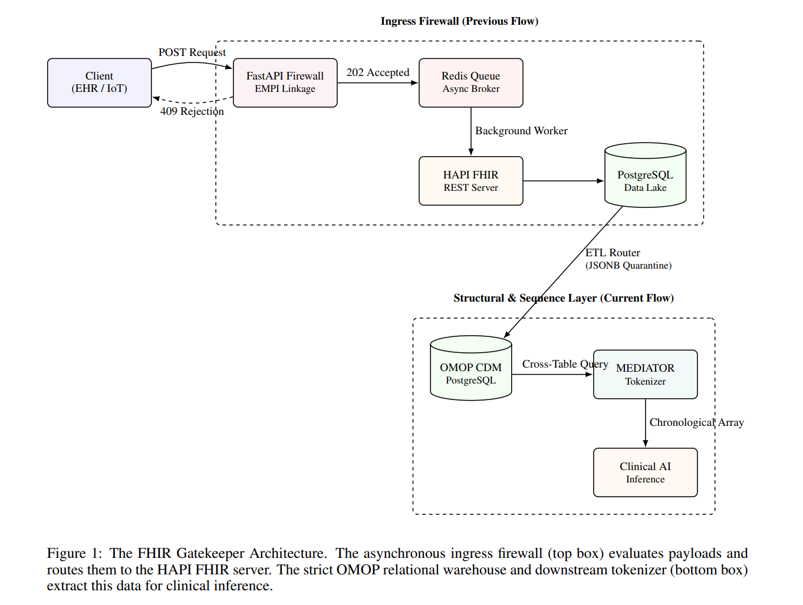

# FHIR Gatekeeper: End-to-End Clinical Data Governance & AI Pipeline

A production-grade, asynchronous semantic interceptor and multi-domain ETL pipeline built with **FastAPI, Redis, DuckDB, and PostgreSQL**. 

Most clinical AI fails in production due to upstream data poisoning. This middleware acts as a high-speed reverse proxy ahead of clinical data lakes (e.g., HAPI FHIR), strictly enforcing identity resolution and physiological plausibility. It then structurally formats the validated data into an OMOP CDM warehouse and tokenizes it for downstream machine learning inference.

## The Three-Stage Architecture

* **The Ingress Firewall (EMPI & Proxy):** Powered by DuckDB, this tier executes in-memory deterministic (ABHA) and probabilistic (Fellegi-Sunter) patient matching to block duplicate identities (HTTP 409). Validated payloads are buffered in Redis to decouple ingestion from persistence, preventing downstream database write-locks.
* **The Structural Warehouse (OMOP CDM):** A multi-domain ETL router flattens FHIR JSON payloads into a strict PostgreSQL OMOP CDM relational schema. It enforces structural idempotency via engine-level primary keys. A declarative rules engine checks LOINC-mapped physiological boundaries, safely routing impossible values (e.g., typos in vitals) into a native JSONB quarantine log for zero data loss.
* **The MEDIATOR Tokenizer:** A sequence extraction layer that queries the OMOP schema to output deterministic, chronologically ordered numerical arrays for patient histories, eliminating natural language parsing for downstream predictive models.

## Benchmark Metrics (High-Concurrency Chaos Load)
* **Throughput:** ~127.45 requests/second
* **p50 Median Latency:** ~92 ms
* **p99 Peak Latency:** ~256 ms
* **Error Rate:** 0.0% (Zero database crashes or data loss under load)

## Getting Started

**1. Start the Infrastructure:** 
Ensure your local Redis, PostgreSQL, and HAPI FHIR instances are running.

    docker-compose up -d

**2. Launch the Proxy:**

    cd src
    python main.py

**3. Run the Chaos Benchmarker:**
Execute the included synthetic load test to verify concurrent routing, EMPI conflict rejection, and JSONB quarantine routing.

    cd tests
    python chaos_benchmarker.py

## Affiliations
Developed by **Dr. Sushant Tapase** (Steth2Tech / Independent Researcher). Built to bridge the gap between theoretical clinical AI models and real-world hospital workflows by trapping data drift at the database boundary.